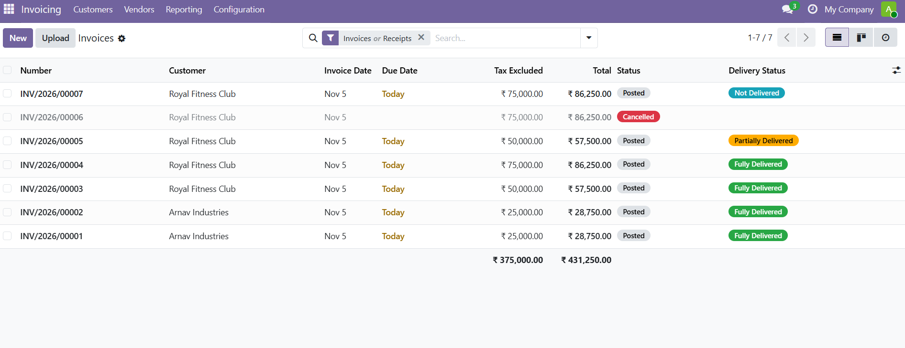
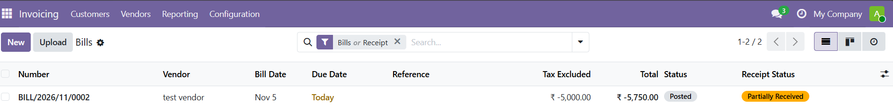

.. image:: https://odoo-community.org/readme-banner-image
   :target: https://odoo-community.org/get-involved?utm_source=readme
   :alt: Odoo Community Association

==============================
Account Invoice Delivery State
==============================

.. 
   !!!!!!!!!!!!!!!!!!!!!!!!!!!!!!!!!!!!!!!!!!!!!!!!!!!!
   !! This file is generated by oca-gen-addon-readme !!
   !! changes will be overwritten.                   !!
   !!!!!!!!!!!!!!!!!!!!!!!!!!!!!!!!!!!!!!!!!!!!!!!!!!!!
   !! source digest: sha256:db29d1a6c9c4f9b803e0541fa1800f390ef41655c0cd84cfa66244f3fc3181f8
   !!!!!!!!!!!!!!!!!!!!!!!!!!!!!!!!!!!!!!!!!!!!!!!!!!!!

.. |badge1| image:: https://img.shields.io/badge/maturity-Beta-yellow.png
    :target: https://odoo-community.org/page/development-status
    :alt: Beta
.. |badge2| image:: https://img.shields.io/badge/license-AGPL--3-blue.png
    :target: http://www.gnu.org/licenses/agpl-3.0-standalone.html
    :alt: License: AGPL-3
.. |badge3| image:: https://img.shields.io/badge/github-OCA%2Faccount--invoicing-lightgray.png?logo=github
    :target: https://github.com/OCA/account-invoicing/tree/19.0/account_invoice_delivery_state
    :alt: OCA/account-invoicing
.. |badge4| image:: https://img.shields.io/badge/weblate-Translate%20me-F47D42.png
    :target: https://translation.odoo-community.org/projects/account-invoicing-19-0/account-invoicing-19-0-account_invoice_delivery_state
    :alt: Translate me on Weblate
.. |badge5| image:: https://img.shields.io/badge/runboat-Try%20me-875A7B.png
    :target: https://runboat.odoo-community.org/builds?repo=OCA/account-invoicing&target_branch=19.0
    :alt: Try me on Runboat

|badge1| |badge2| |badge3| |badge4| |badge5|

This module adds **Delivery Status** and **Receipt Status** fields to
customer invoices and vendor bills, giving accounting teams real-time
visibility into how much of each invoice is backed by validated stock
movements.

- **Customer Invoices** display a ``Delivery Status`` badge: *Not
  Delivered*, *Partially Delivered*, or *Fully Delivered*, computed from
  the linked sales order lines' delivered quantities.
- **Vendor Bills** display a ``Receipt Status`` badge: *Not Received*,
  *Partially Received*, or *Fully Received*, computed from the linked
  purchase order lines' received quantities.
- Status is ``False`` (badge hidden) for invoices/bills that contain
  only service products or have no source order, avoiding noise for
  non-stock transactions.
- Both fields are **stored and indexed**, making them searchable and
  groupable in list views and via the ORM.
- A **Delivery Status** column is also available on the customer portal
  (``/my/invoices``) so customers can track fulfilment alongside
  payment.

**Table of contents**

.. contents::
   :local:

Usage
=====

Customer Invoices
-----------------

1. Go to *Accounting → Customers → Invoices*.
2. The **Delivery Status** column shows a coloured badge:

   - 🔵 **Not Delivered** – no delivery picking has been validated yet.
   - 🟡 **Partially Delivered** – at least one unit shipped, remainder
     outstanding.
   - 🟢 **Fully Delivered** – all invoiced storable quantities have been
     shipped.

3. Use the **Filters** menu to filter by delivery state, or **Group By →
   Delivery Status** to segment the list.
4. Open any invoice to see the badge inline next to the payment state.

|Customer Invoices Delivery Status|

Vendor Bills
------------

1. Go to *Accounting → Vendors → Bills*.
2. The **Receipt Status** column appears with the same three states (Not
   / Partially / Fully Received).
3. Filter by receipt state to identify bills that can be safely released
   for payment under 3-way matching.

|Vendor Bills Receipt Status|

Customer Portal
---------------

Logged-in portal users can see the **Delivery Status** badge on
``/my/invoices`` and on each invoice's detail page. No
warehouse-internal identifiers are exposed.

Notes
-----

- Invoices or bills containing **only service products** (or with no
  linked sales/purchase order) will not show a delivery/receipt status
  badge.
- The status recomputes automatically whenever the linked order lines'
  delivered or received quantities change.

Bug Tracker
===========

Bugs are tracked on `GitHub Issues <https://github.com/OCA/account-invoicing/issues>`_.
In case of trouble, please check there if your issue has already been reported.
If you spotted it first, help us to smash it by providing a detailed and welcomed
`feedback <https://github.com/OCA/account-invoicing/issues/new?body=module:%20account_invoice_delivery_state%0Aversion:%2019.0%0A%0A**Steps%20to%20reproduce**%0A-%20...%0A%0A**Current%20behavior**%0A%0A**Expected%20behavior**>`_.

Do not contact contributors directly about support or help with technical issues.

Credits
=======

Authors
-------

* Allied Vision Technologies Pvt. Ltd.

Contributors
------------

- Pratik Gunjal <<pratikgunjal@alliedvision.in>>

Maintainers
-----------

This module is maintained by the OCA.

.. image:: https://odoo-community.org/logo.png
   :alt: Odoo Community Association
   :target: https://odoo-community.org

OCA, or the Odoo Community Association, is a nonprofit organization whose
mission is to support the collaborative development of Odoo features and
promote its widespread use.

.. |maintainer-pratikgunjal-maker| image:: https://github.com/pratikgunjal-maker.png?size=40px
    :target: https://github.com/pratikgunjal-maker
    :alt: pratikgunjal-maker

Current `maintainer <https://odoo-community.org/page/maintainer-role>`__:

|maintainer-pratikgunjal-maker| 

This module is part of the `OCA/account-invoicing <https://github.com/OCA/account-invoicing/tree/19.0/account_invoice_delivery_state>`_ project on GitHub.

You are welcome to contribute. To learn how please visit https://odoo-community.org/page/Contribute.
